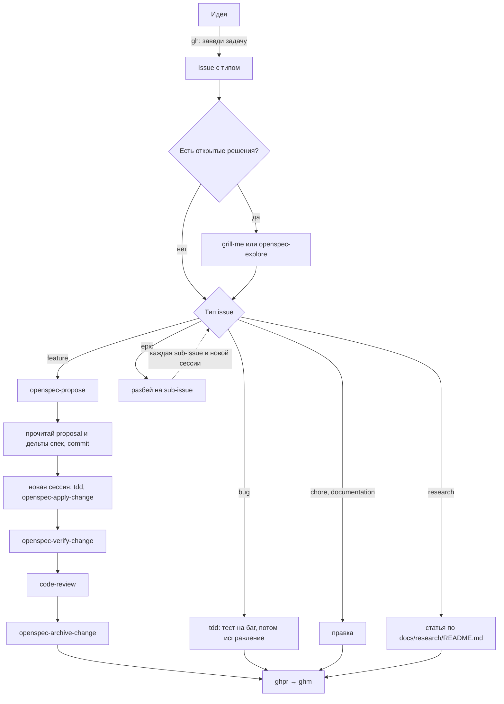

# Как работать в Spook

Spook ведёт один человек вместе с агентами разработки (Claude Code, opencode, Codex…). Каждый шаг — скилл, который ты вызываешь сам. Правила для агентов — в `AGENTS.md`.

## После клона

Нужен OpenSpec 2.0, как в CI. Скиллы OpenSpec каждый создаёт у себя:

```bash
openspec config set profile custom
openspec config set workflows '["propose","explore","apply","update","sync","archive","verify"]'
openspec init --tools <агент>   # claude, opencode, codex…
```

Остальные скиллы глобальные, лежат в `~/.agents/skills/`.

## Путь задачи



- Тип ставит агент разработки, когда заводит issue. После обсуждения задача больше чем на один PR становится `epic`.
- `grill-me` — когда варианты понятны и решения надо принять. `openspec-explore` — когда задачу ещё надо понять.
- Работаешь параллельно — каждая ветка в своём worktree.

## Merge

- В `main` попадают только PR с зелёным CI, через squash. Апрув не нужен.
- Вливай через `ghm`, а не кнопкой на сайте: кнопка повторит трейлеры в сообщении коммита.
